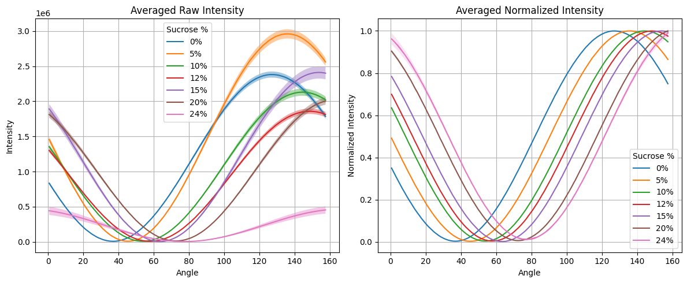
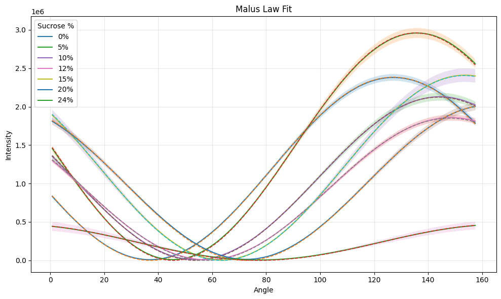
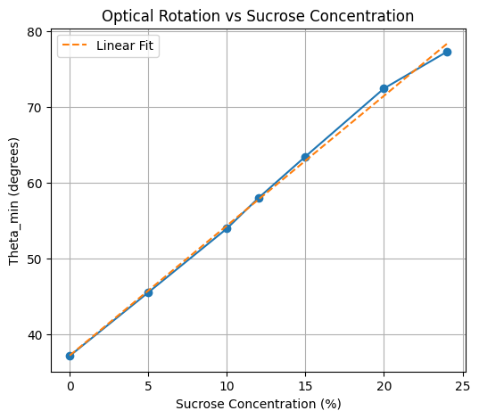
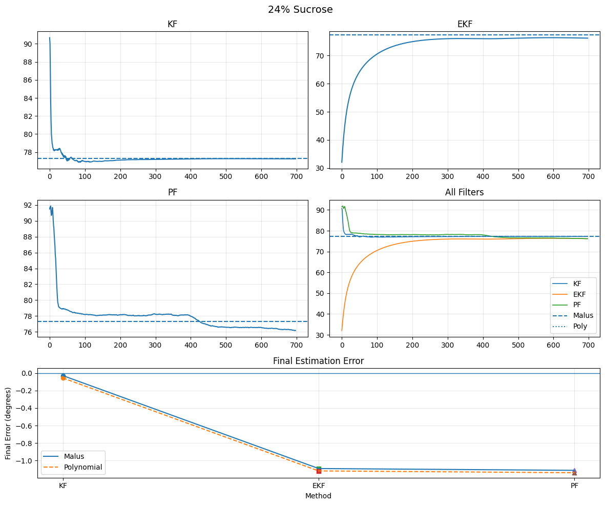
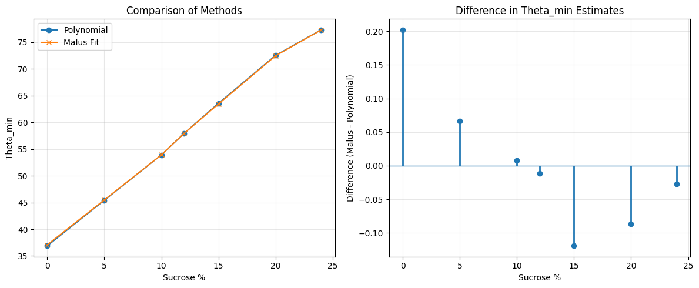

# Polarimetry State Estimation: Malus' Law, Kalman Filters and Particle Filters

Estimating the optical rotation of sucrose solutions from noisy polarimeter measurements. As the analyser angle is swept, the light intensity follows Malus' law, and the angle of minimum intensity (theta_min) shifts with sugar concentration. Five ways of estimating theta_min are compared:
- two batch methods: a nonlinear Malus-law fit and a local polynomial fit;
- three recursive filters: a linear Kalman filter, an extended Kalman filter (EKF) and a particle filter.

## Coursework

Assignment on state estimation for **Control and Planning (CAPN)**, Semester 6 (Spring 2026), Plaksha University. The repository also contains the course's kinematics and motion-control exercises (see below).

## Data

`data/angle_intensity_0-24/` has 21 CSV files: 7 sucrose concentrations (0, 5, 10, 12, 15, 20 and 24%) x 3 trials, each with 5 repeated sweeps of 698 angles from 0.7 to 157.5 degrees. The 15 sweeps at each concentration are averaged, and their standard deviation is shown as the noise band.



*Averaged raw and normalised intensity against analyser angle for each concentration; the bands are ± 1 standard deviation across the 15 sweeps.*

## Methods

| Method | Type | How theta_min is obtained |
|---|---|---|
| Malus-law fit | Batch | Nonlinear least squares of I0 sin^2(theta - theta_min) to the whole averaged curve (used as the reference) |
| Polynomial fit | Batch | 5th-order polynomial fitted to 40 points around the lowest reading, then minimised |
| Linear Kalman filter | Recursive | Malus' law with an offset is rewritten exactly as I = a - b cos 2theta - c sin 2theta, which is linear in [a, b, c]. Then theta_min = 0.5 atan2(c, b) |
| Extended Kalman filter | Recursive | The state is theta_min. sin^2 is linearised with its analytical Jacobian. Starts at 30 degrees |
| Particle filter | Recursive | 1,000 particles start uniformly on [0, 180), get Gaussian likelihood weights and are resampled after every measurement |

## Results



*Averaged curves (solid) and the fitted Malus-law curves (dashed) for every concentration.*



*theta_min from the Malus fit against concentration: theta_min = 1.716 x concentration + 37.14 degrees.*

Final estimate minus the Malus-fit value (degrees):

| Sucrose % | Malus theta_min | Polynomial | Linear KF | EKF | PF |
|---|---|---|---|---|---|
| 0 | 37.09 | -0.20 | +0.03 | +0.07 | +0.39 |
| 5 | 45.48 | -0.07 | +0.02 | -0.02 | +0.22 |
| 10 | 53.92 | -0.01 | +0.02 | -0.01 | +0.56 |
| 12 | 57.94 | +0.01 | +0.02 | +0.02 | +0.34 |
| 15 | 63.44 | +0.12 | +0.01 | -0.12 | +0.09 |
| 20 | 72.44 | +0.09 | -0.00 | -0.57 | -0.66 |
| 24 | 77.28 | +0.03 | -0.03 | -1.09 | -1.11 |



*How the three filters' estimates evolve during the sweep at 24% sucrose (dashed line: Malus fit), and their final errors.*



*Polynomial and Malus-fit estimates for each concentration, and the difference between them.*

Findings:
- **The linear Kalman filter is the best estimator here:** within 0.035 degrees of the Malus fit at every concentration, cheap to run, recursive and independent of any initial guess.
- **The polynomial fit** agrees with the Malus fit to within 0.2 degrees, but it is a batch method and depends on the chosen window.
- **The EKF** is accurate up to 15% sucrose. At 20-24% it settles 0.6-1.1 degrees short. It climbs slowly from its 30-degree start and its covariance shrinks before it reaches the answer.
- **The particle filter** is within 1.1 degrees. It is the most expensive method and needs the most tuning: with my first settings (200 particles, 0.5-degree roughening) its errors reached 3 degrees.

The notebook ends with a full discussion of computational demand, implementation complexity, real-time use and when to prefer each method.

## Kinematics and motion-control exercises

`robot_kinematics_exercises.ipynb` contains the course's shorter exercises:
- forward kinematics of a 2-link arm, with DH parameters and in closed form;
- the unicycle and differential-drive models (Python versions of Simulink models built in class);
- a proportional go-to-goal controller, extended to follow a list of waypoints.

## Files

| File | Contents |
|---|---|
| `polarimetry_state_estimation.ipynb` | Data loading, Malus fit, polynomial fit, the three filters, results and analysis |
| `robot_kinematics_exercises.ipynb` | Kinematics and motion-control exercises |
| `data/angle_intensity_0-24/` | Polarimeter measurements |
| `images/` | Figures used in this README, exported from the notebook |

## How to run

```
pip install -r requirements.txt
jupyter notebook polarimetry_state_estimation.ipynb
```

## Notes on the cleanup

- The data path was hard-coded to my OneDrive folder. It is now relative to the repository.
- My first "KF" linearised sin^2 numerically around the current estimate, which made it the same algorithm as the EKF, so the two printed identical numbers. It is now a genuine linear Kalman filter, based on the exact linear rewrite of Malus' law.
- The particle filter now uses 1,000 particles with 0.05-degree roughening (previously 200 and 0.5 degrees) and a fixed random seed, so results are reproducible.
- The analysis was rewritten to match the new results. The earlier conclusion that KF and EKF perform identically came from the bug above.
